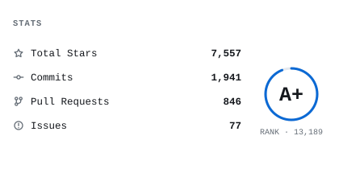
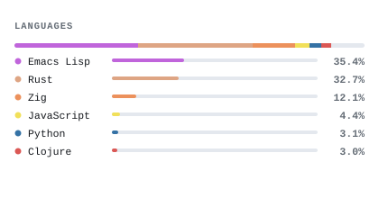
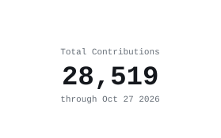
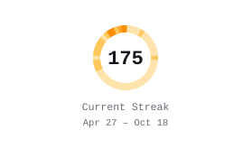
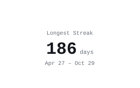

<p align="center">
  <picture><source media="(max-width: 768px) and (prefers-color-scheme: dark)" srcset="./profile/stats-narrow-dark.svg" /><source media="(max-width: 768px)" srcset="./profile/stats-narrow-light.svg" /><source media="(prefers-color-scheme: dark)" srcset="./profile/stats-dark.svg" /></picture>
  <picture><source media="(max-width: 768px) and (prefers-color-scheme: dark)" srcset="./profile/languages-narrow-dark.svg" /><source media="(max-width: 768px)" srcset="./profile/languages-narrow-light.svg" /><source media="(prefers-color-scheme: dark)" srcset="./profile/languages-dark.svg" /></picture>
</p>

<p align="center">
  <picture><source media="(prefers-color-scheme: dark)" srcset="./profile/total-dark.svg" /></picture>
  <picture><source media="(prefers-color-scheme: dark)" srcset="./profile/heat-dark.svg" /></picture>
  <picture><source media="(prefers-color-scheme: dark)" srcset="./profile/longest-dark.svg" /></picture>
</p>

<!--  -->

<!--START_SECTION:activity-->
```text
From: 26 July 2026 - To: 16 October 2026

LINES BY LANGUAGE

Total      +42,359   lines, 100.00% by an agent

Rust        +9,086   #########################   21.44 %   100.00% agent   1 hrs 46 mins
Swift       +6,421   ##################-------   15.15 %   100.00% agent   1 hrs 32 mins
Markdown    +5,969   ################---------   14.09 %   100.00% agent   2 hrs 20 mins
Dart        +5,096   ##############-----------   12.03 %   100.00% agent   1 hrs 33 mins
Python      +3,201   #########----------------    7.55 %   100.00% agent   0 hrs 41 mins
Kotlin      +2,436   #######------------------    5.75 %   100.00% agent   0 hrs  6 mins

# agent    = unattributed    - rest
```
<!--END_SECTION:activity-->
