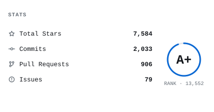
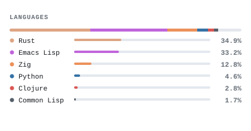
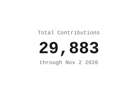
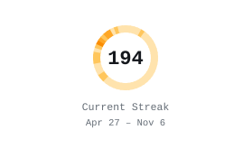
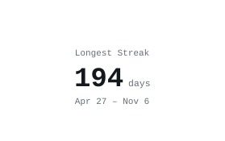

<p align="center">
  <picture><source media="(max-width: 768px) and (prefers-color-scheme: dark)" srcset="./profile/stats-narrow-dark.svg" /><source media="(max-width: 768px)" srcset="./profile/stats-narrow-light.svg" /><source media="(prefers-color-scheme: dark)" srcset="./profile/stats-dark.svg" /></picture>
  <picture><source media="(max-width: 768px) and (prefers-color-scheme: dark)" srcset="./profile/languages-narrow-dark.svg" /><source media="(max-width: 768px)" srcset="./profile/languages-narrow-light.svg" /><source media="(prefers-color-scheme: dark)" srcset="./profile/languages-dark.svg" /></picture>
</p>

<p align="center">
  <picture><source media="(prefers-color-scheme: dark)" srcset="./profile/total-dark.svg" /></picture>
  <picture><source media="(prefers-color-scheme: dark)" srcset="./profile/heat-dark.svg" /></picture>
  <picture><source media="(prefers-color-scheme: dark)" srcset="./profile/longest-dark.svg" /></picture>
</p>

<!--  -->

<!--START_SECTION:activity-->
```text
From: 26 July 2026 - To: 9 November 2026

LINES BY LANGUAGE

Total        +36,621   lines, 100.00% by an agent

Rust          +8,577   #########################   23.42 %   100.00% agent    1 hrs 59 mins
Markdown      +8,256   ########################-   22.54 %   100.00% agent   10 hrs  7 mins
Python        +8,218   ########################-   22.44 %   100.00% agent    1 hrs 38 mins
Dart          +5,019   ###############----------   13.70 %   100.00% agent    1 hrs 33 mins
JavaScript    +1,493   ####---------------------    4.07 %   100.00% agent    0 hrs 43 mins
Other         +1,288   ####---------------------    3.51 %   100.00% agent    0 hrs 35 mins

# agent    = unattributed    - rest
```
<!--END_SECTION:activity-->
