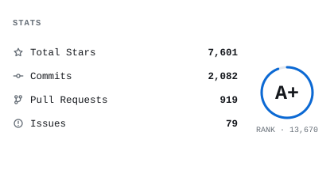

<p align="center">
  <picture><source media="(max-width: 768px) and (prefers-color-scheme: dark)" srcset="./profile/stats-narrow-dark.svg" /><source media="(max-width: 768px)" srcset="./profile/stats-narrow-light.svg" /><source media="(prefers-color-scheme: dark)" srcset="./profile/stats-dark.svg" /></picture>
  <picture><source media="(max-width: 768px) and (prefers-color-scheme: dark)" srcset="./profile/languages-narrow-dark.svg" /><source media="(max-width: 768px)" srcset="./profile/languages-narrow-light.svg" /><source media="(prefers-color-scheme: dark)" srcset="./profile/languages-dark.svg" /></picture>
</p>

<p align="center">
  <picture><source media="(prefers-color-scheme: dark)" srcset="./profile/total-dark.svg" /></picture>
  <picture><source media="(prefers-color-scheme: dark)" srcset="./profile/heat-dark.svg" /></picture>
  <picture><source media="(prefers-color-scheme: dark)" srcset="./profile/longest-dark.svg" /></picture>
</p>

<!--  -->

<!--START_SECTION:activity-->
```text
From: 26 July 2026 - To: 20 November 2026

LINES BY LANGUAGE

Total        +19,414   lines, 100.00% by an agent

Other         +9,165   #########################   47.20 %   100.00% agent   2 hrs 28 mins
Python        +4,545   ############-------------   23.41 %   100.00% agent   0 hrs 59 mins
Rust          +1,926   #####--------------------    9.92 %   100.00% agent   0 hrs 37 mins
Markdown      +1,779   #####--------------------    9.16 %   100.00% agent   1 hrs  2 mins
JavaScript    +1,164   ###----------------------    5.99 %   100.00% agent   0 hrs 40 mins
Emacs Lisp      +424   #------------------------    2.18 %   100.00% agent   0 hrs  7 mins

# agent    = unattributed    - rest
```
<!--END_SECTION:activity-->
