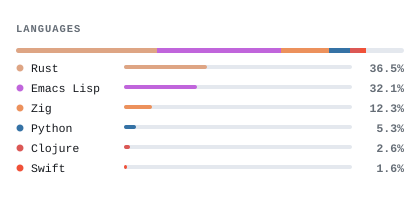
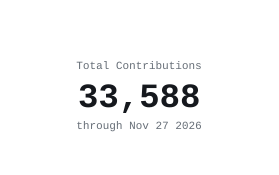
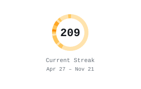
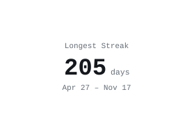

<p align="center">
  <picture><source media="(max-width: 768px) and (prefers-color-scheme: dark)" srcset="./profile/stats-narrow-dark.svg" /><source media="(max-width: 768px)" srcset="./profile/stats-narrow-light.svg" /><source media="(prefers-color-scheme: dark)" srcset="./profile/stats-dark.svg" /></picture>
  <picture><source media="(max-width: 768px) and (prefers-color-scheme: dark)" srcset="./profile/languages-narrow-dark.svg" /><source media="(max-width: 768px)" srcset="./profile/languages-narrow-light.svg" /><source media="(prefers-color-scheme: dark)" srcset="./profile/languages-dark.svg" /></picture>
</p>

<p align="center">
  <picture><source media="(prefers-color-scheme: dark)" srcset="./profile/total-dark.svg" /></picture>
  <picture><source media="(prefers-color-scheme: dark)" srcset="./profile/heat-dark.svg" /></picture>
  <picture><source media="(prefers-color-scheme: dark)" srcset="./profile/longest-dark.svg" /></picture>
</p>

<!--  -->

<!--START_SECTION:activity-->
```text
From: 26 July 2026 - To: 20 November 2026

LINES BY LANGUAGE

Total        +22,726   lines, 100.00% by an agent

Other        +10,064   #########################   44.28 %   100.00% agent   2 hrs 52 mins
Python        +4,852   ############-------------   21.34 %   100.00% agent   1 hrs  6 mins
JavaScript    +2,216   ######-------------------    9.75 %   100.00% agent   1 hrs 20 mins
Markdown      +2,064   #####--------------------    9.08 %   100.00% agent   1 hrs 12 mins
Rust          +1,926   #####--------------------    8.47 %   100.00% agent   0 hrs 37 mins
Go              +902   ##-----------------------    3.96 %   100.00% agent   0 hrs 11 mins

# agent    = unattributed    - rest
```
<!--END_SECTION:activity-->
